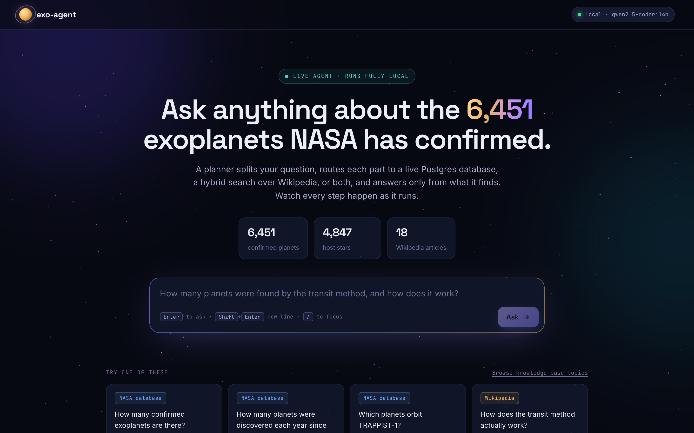
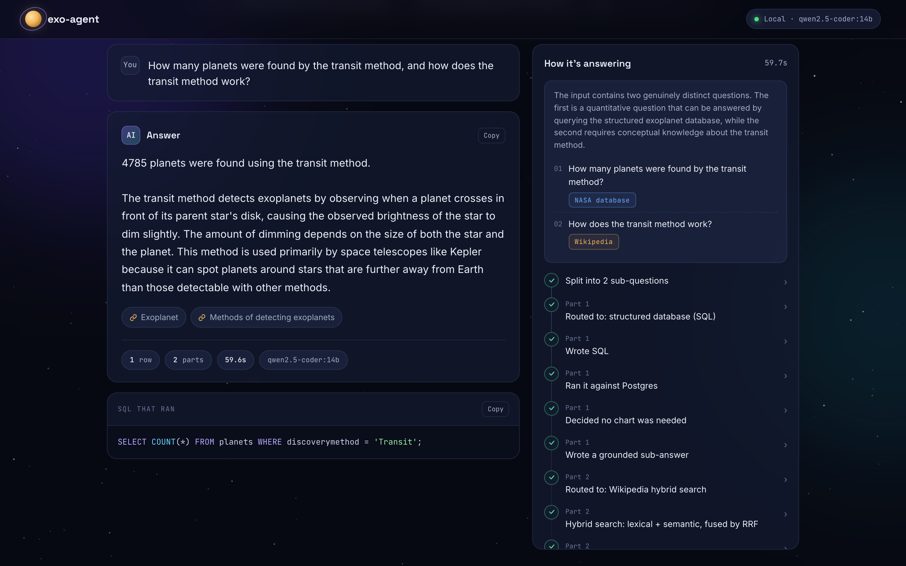
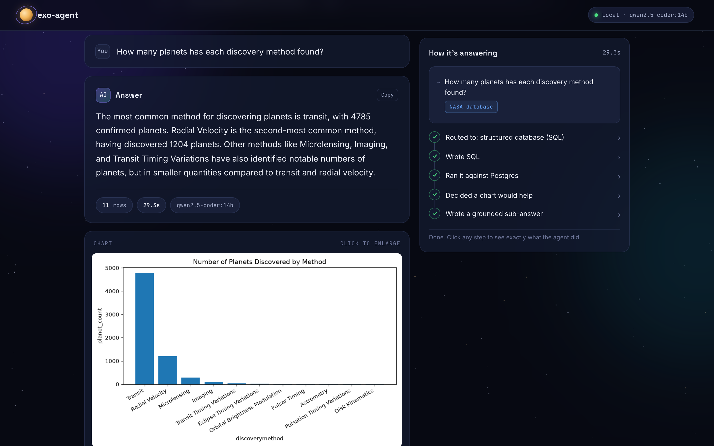

# exo-agent

[](https://github.com/yashbagia1708/exo-agent/actions/workflows/ci.yml)
[](https://github.com/yashbagia1708/exo-agent/actions/workflows/pipeline.yml)

A natural-language-to-insight agent over real NASA exoplanet data. Ask a
question in plain English; it decomposes compound questions, routes each
part to a live PostgreSQL database and/or a hybrid Wikipedia search,
verifies named entities against real data instead of guessing, decides
whether a chart would help, and answers in plain English, grounded
strictly in what the data and retrieved sources actually show.

Built to learn agentic AI patterns properly: multi-step decomposition,
tool routing, RAG/hybrid retrieval, tool-call repair loops, structured
outputs, and an evaluation-first mindset, rather than a single
prompt-and-pray chatbot.

```
"List the planets orbiting TRAPPIST-1, and what is the Kepler space telescope?"
  -> splits into 2 independent sub-questions
  -> sub-question 1: verifies "TRAPPIST-1" against the real database,
     queries it, returns all 7 known planets
  -> sub-question 2: hybrid search finds the real Wikipedia article,
     no SQL involved
  -> "The planets orbiting TRAPPIST-1 are b, c, d, e, f, g, and h.
      Separately, the Kepler space telescope was a NASA observatory
      that operated from 2009 to 2018..." (with a cited source link)
```

## Screenshots

The demo UI runs locally (`python3 launch.py`) and shows each step as the
agent works.



**A compound question.** The planner splits it in two, sends one part to
the NASA database and the other to Wikipedia, and the trace on the right
shows each step. The SQL that ran sits under the answer.



**A chart question.** The chart is drawn from the rows the query actually
returned, and the agent decides on its own whether a chart helps.



## Why this exists

I work as a Data Analyst, and I kept finding myself reaching for AI and
automation beyond what the role strictly asked for: automating manual
ETL steps, building an internal NL-to-SQL assistant, that kind of thing.
This project is the next step: building a genuinely agentic system from
scratch, with the discipline (evaluation, repair loops, grounding) that
separates "a chatbot that demos well" from a system you can actually
trust.

It's deliberately built on a topic I'm personally curious about (NASA's
real exoplanet catalogue) rather than another retail/Titanic dataset.

## Architecture

The agent decomposes the input into 1–N independent sub-questions, runs
each through its own routing/tool/answer pipeline, then stitches the
grounded sub-answers into one final answer word for word, with no LLM
call (a single sub-answer passes straight through):

```
question
   │
   v
planner ──► decomposes into 1-N sub-questions, each independently routed
   │         to SQL, retrieval, or both
   │
   ├── sub-question 1 ──► [if needs_sql]  entity_resolver → sql_writer →
   │                        executor → chart_decider → [chart_generator]
   │                      [if needs_retrieval]  retriever (hybrid search)
   │                                                       │
   │                                                       v
   │                                              insight_writer
   │                                          (grounded sub-answer,
   │                                           sources, caveat)
   │
   ├── sub-question 2 ──► (same per-sub-question pipeline)
   │
   └── sub-question N ──► ...
                              │
                              v
                       synthesizer ──► sub-answers stitched together verbatim
                       (skipped, as a passthrough, if there was only
                        1 sub-question, the common case)
```

Implemented as a real [LangGraph](https://github.com/langchain-ai/langgraph)
`StateGraph` (`src/exo_agent/graph.py`): an outer graph runs the
planner/synthesizer, and an inner compiled sub-graph runs once per
sub-question. Chart generation and tool routing are genuine conditional
edges, not if-statements hidden inside a node. Sub-questions run
sequentially (not LangGraph's parallel `Send` fan-out). That's a deliberate
choice since most real input is 1 sub-question anyway, sequential output
stays readable in trace order, and a single local Ollama instance can't
meaningfully parallelize multiple concurrent calls regardless.

### The two knowledge sources

- **Structured data:** real SQL against a live PostgreSQL database of
  every confirmed exoplanet (6,451 as of the latest download). Used for counts, comparisons, trends,
  named-entity lookups.
- **Unstructured knowledge:** hybrid search (lexical full-text +
  semantic vector search, fused via Reciprocal Rank Fusion) over 18
  curated Wikipedia articles on detection methods and astronomy concepts.
  Used for "what is X" / "how does X work" questions with no column in
  the database.

The planner decides per-sub-question which source(s) a question actually
needs. This is the agent's real routing/tool-selection behavior, not a
fixed pipeline that always runs both.

## What makes this more than a wrapper around an LLM

- **Grounded, not memorized.** The agent never states a number or fact
  from memory: every number traces back to a real SQL row, every
  concept traces back to a cited, retrieved Wikipedia passage.
- **Verifies named entities instead of guessing them.** When a question
  names a specific planet/star, `entity_resolver.py` looks it up against
  the real database using Postgres's `pg_trgm` trigram similarity:
  deterministic string matching, not an LLM guess at catalogue naming
  conventions (e.g. correctly resolving "Proxima Centauri b" to the real
  stored value "Proxima Cen b"). See FINDINGS.md for the bug this fixed.
- **Two repair loops.** A lightweight structural validator catches
  malformed SQL (truncated CTEs, unbalanced parens) before it ever
  reaches Postgres; the executor catches *semantic* errors (wrong types,
  bad joins) using Postgres's own real error message, and retries with
  that error fed back to the model.
- **Decomposes compound questions.** A message joining two unrelated
  asks ("list X, and also tell me Y") is split into independent
  sub-questions before any SQL is written, fixing a real bug where a
  fused query silently answered neither part correctly.
- **Provider-agnostic by design.** Every LLM call goes through one
  `instructor`-wrapped client (`src/exo_agent/providers/factory.py`).
  Swapping between local Ollama models and Claude/OpenAI is a one-line
  config change (`PROVIDER=ollama` vs `PROVIDER=anthropic`), with zero
  changes to any node's logic.
- **Evaluated, not vibe-checked.** `eval/run_eval.py` runs each
  hand-written test question 5 times and reports a *pass rate*, not a
  single pass/fail, because LLM behavior on identical input isn't
  deterministic, and a single clean test run can be misleading (see
  FINDINGS.md for a real, concrete example of exactly this).
- **A live, inspectable demo.** The frontend (`frontend/`) streams a
  step-by-step trace as the agent runs: the plan (which sub-question goes
  to the database vs. Wikipedia), each node as it finishes, then the
  answer with its sources, chart and the SQL that ran. The trace is built
  from the agent's actual execution state, not a separate, prettified
  fiction of what happened.

## results

Run against `qwen2.5-coder:14b` (local, free, via Ollama). Tiers 1-3 and
5 were run on the June 2026 snapshot (6,298 planets), tier 4 on the
October 2026 one (6,451):

| Tier | What it tests | Pass rate |
|---|---|---|
| 1: basic lookups | Simple counts, filters, ORDER BY | 22/25 (88%) |
| 2: joins & aggregation | Multi-table joins, GROUP BY | 17/20 (85%) |
| 3: time trends | Chart-worthy trend questions | 10/10 (100%) |
| 4: compound & dependent | Multi-part questions through the whole graph | 27/30 (90%) |
| 5: limits & refusal | Should the agent decline/caveat? | 10/15 (67%) |

Tier 4 runs the whole agent (planner, every part, the stitched answer)
on questions like "which planet is most Earth-like, and how far is it?".
Splitting, routing and keeping dependent parts together held in every
run; the 3 misses were SQL mistakes inside a part, e.g. `ILIKE
'%Transit%'` also counting "Transit Timing Variations" planets (details
in [`FINDINGS.md`](./FINDINGS.md)).

The tier 5 number is the most important one, and it's the one I'd flag
first in an interview rather than hide: **the question "which planet has
confirmed life on it" was only correctly declined in 1 of 5 runs.**
Questions with a real proxy column to fall back on (e.g. "surface
temperature" → equilibrium temperature) are handled fairly reliably (4/5).
Questions with *no* answerable basis at all in the dataset are handled
much less reliably. That's a genuine, current limitation of this system,
not a solved problem. Seeing this clearly is the actual point of having
an eval harness instead of just trying a few demo questions and feeling
good about it.

**A second limitation, found and then fixed: the synthesis step.** When a
compound question split into 3+ sub-questions and one asked for something
outside the schema (e.g. "which planet has the highest radial velocity";
there's no measured velocity column, only a detection-method label), the
step that combined sub-answers was itself an LLM call, and it broke
grounding twice: once inventing an "as of my knowledge cutoff" disclaimer,
then, after a prompt fix, contradicting a correct sub-answer ("no planets
were found" when the SQL had just returned 200 rows). After two
prompt-level fixes failed to hold, the synthesizer was rebuilt to stitch
sub-answers together verbatim with no model call, so it can no longer add
to or contradict them; regression tests replay both failures in CI.

That exposed the real source of the radial-velocity claims: the insight
writer, which had no rule against ranking by a quantity the data doesn't
contain. Adding one took false "highest radial velocity" answers from
**5/5 to 0/5** in live runs, with the caveat present in all 5, but 1 of 5
runs still made a different false claim about the same missing data. So:
much better and measured, not solved. Details, including the trade-off
(combined answers read as separate paragraphs rather than flowing
prose), are in [`FINDINGS.md`](./FINDINGS.md)'s 2026-10-26 entries.

Full breakdown, including *why* particular failures happened and what
was tried, is in [`FINDINGS.md`](./FINDINGS.md), a dated log covering
distinct failure categories found during development: instruction
overreach, structural SQL truncation, semantic type errors, silent
NULL-as-extremum bugs, unreliable refusal behavior, entity-name guessing
vs. deterministic verification, a physical-reasoning direction error, and
the synthesizer grounding gap described above and how it was closed.

## Model comparison

Also compared `llama3.1:8b` (general-purpose) against
`qwen2.5-coder:14b` (code-specialized) on identical questions.
`qwen2.5-coder:14b` converged correctly on every case tested, including
one where `llama3.1:8b` oscillated between two wrong SQL fixes without
ever finding the right one. Full comparison in `FINDINGS.md`. This is
why `qwen2.5-coder:14b` is the default model, backed by measured evidence
rather than a guess.

The provider/model is swappable at zero code cost:

```bash
PROVIDER=ollama MODEL=qwen2.5-coder:14b python3 -m exo_agent.graph "..."
PROVIDER=anthropic MODEL=claude-sonnet-4-6 python3 -m exo_agent.graph "..."
```

## The data

[NASA Exoplanet Archive](https://exoplanetarchive.ipac.caltech.edu/),
PSCompPars table: every confirmed exoplanet and its host star (6,451
planets across 4,847 stars as of the latest download), downloaded directly via NASA's public TAP API
(`data/download_data.py`) and split into a two-table relational schema
(`data/load_to_postgres.py`).

Real astronomy data comes with real messiness: stellar parameters
sometimes disagree slightly across a star's planet rows (different
literature references), and several columns have genuine missing
measurements rather than zeros. Both are documented honestly in
[`data/data_quality_notes.md`](./data/data_quality_notes.md), generated
automatically by the loader, not hand-written after the fact.

## Project structure

```
exo-agent/
├── README.md, FINDINGS.md          ← start here: overview + the honest bug log
│
├── src/exo_agent/                  ← the actual agent package
│   ├── graph.py                     LangGraph wiring: decomposer → per-sub-question
│   │                                pipeline → synthesizer (see Architecture above)
│   ├── config.py                    provider/model selection, DB connection
│   ├── schemas.py                   every Pydantic structured-output model
│   ├── schema_context.py            real DB schema description fed to the LLM,
│   │                                including every worked-example fix from FINDINGS.md
│   ├── sql_validator.py             structural SQL validation, pre-execution
│   ├── retrieval.py                 hybrid search: lexical + semantic, RRF-fused
│   ├── providers/
│   │   └── factory.py               provider-agnostic client (Ollama/Claude/OpenAI)
│   └── nodes/                       one file per pipeline stage
│       ├── planner.py                decomposes input, routes each sub-question
│       ├── entity_resolver.py        verifies named planets/stars via pg_trgm
│       │                             similarity (not LLM guessing)
│       ├── sql_writer.py             NL → validated SQL
│       ├── executor.py               runs SQL, repairs on real Postgres errors
│       ├── chart_decider.py          decides chart type from actual result shape
│       ├── chart_generator.py        matplotlib rendering, no LLM call
│       └── insight_writer.py         grounded answer + caveat + cited sources
│
├── data/                            ← everything that builds the two knowledge sources
│   ├── download_data.py              pulls real planet data from NASA's public API
│   ├── load_to_postgres.py           builds the host_stars + planets schema
│   ├── data_quality_notes.md         auto-generated data quality findings
│   ├── download_wiki_corpus.py       pulls ~18 curated Wikipedia articles
│   ├── load_wiki_to_postgres.py      embeds + loads them into wiki_chunks (pgvector)
│   ├── RAG_SETUP.md                  step-by-step setup for the retrieval layer
│   └── README.md                     step-by-step setup for the structured-data layer
│
├── eval/                            ← the evaluation harness
│   ├── questions.jsonl               hand-written test questions across 5 tiers
│   └── run_eval.py                   runs each question 5x, reports PASS RATES
│
├── frontend/                        ← the live demo UI
│   ├── server.py                     FastAPI backend; calls graph.py directly,
│   │                                 no separate/simplified agent logic
│   ├── static/index.html             single-page UI: routing summary, full trace,
│   │                                 sources, charts, topic browser
│   └── README.md                     how to run the demo
│
├── tests/                           ← deterministic unit tests, run by CI
├── docs/screenshots/                ← the UI images used in this README
├── docker-compose.yml, docker/      ← local Postgres with pgvector + pg_trgm
├── Makefile                         ← setup / load / serve / test shortcuts
│
├── launch.py                        ← one-command launcher (python3 launch.py)
├── compare_models.py                side-by-side local-model comparison tool
├── test_provider.py                  quick smoke test for the provider layer
└── PROJECT_CONTEXT.md               compact project-state summary for resuming
                                      work in a fresh chat session
```

**Reading order, if you're new to this repo:** `README.md` (this file) →
the architecture diagram above → `FINDINGS.md` for the real bugs and
fixes → `src/exo_agent/graph.py` for the actual wiring → any individual
`nodes/*.py` file for a specific stage's logic.

## Running it

Needs Python 3.10+, Docker, and [Ollama](https://ollama.com). Everything
runs locally and free. One command starts it all:

```bash
python3 launch.py     # or: make demo
```

The launcher creates `.venv`, starts Postgres in Docker and the Ollama
server, pulls the models, loads the data on first run, then opens the UI
at http://localhost:8420. Anything already running is reused, and Ctrl+C
stops what it started. The first run downloads about 9 GB of models;
after that it's up in seconds.

To run the steps yourself instead:

```bash
make setup        # .venv + dependencies, and .env copied from .env.example
make db-up        # Postgres 16 + pgvector + pg_trgm in Docker, on localhost:5433
ollama serve      # in its own terminal
make models       # pulls qwen2.5-coder:14b and nomic-embed-text
make load-data    # downloads NASA's planet table, loads it, embeds the wiki corpus
```

Then:

```bash
.venv/bin/python -m exo_agent.graph "How many confirmed exoplanets are there?"
make serve        # live demo UI at http://localhost:8420
make test         # deterministic unit tests (no LLM or database), same as CI
make eval         # LLM eval harness: each question 5x, reports pass rates (slow)
```

`make help` lists every target. To use Claude or OpenAI instead of
Ollama, set `PROVIDER` and the matching API key in `.env`.

If you'd rather use an existing Postgres than Docker, point `DB_DSN` in
`.env` at it; `data/README.md` and `data/RAG_SETUP.md` cover installing
the extensions by hand.

## Workflows (GitHub Actions)

| Workflow | Runs | What it does |
|---|---|---|
| `ci` | every push to main, every PR | ruff + unit tests on Python 3.10 and 3.12 (no model, no database) |
| `pipeline` | every push to main, every PR | loads NASA's live table and the wiki corpus into real Postgres (pgvector) with Ollama embeddings, re-loads to prove it's repeatable, then runs the database checks in `tests/integration` (search, entity matching, 0-row filter check, NULLS LAST). Counts and data-quality notes are attached to the run |
| `smoke-eval` | manual | the whole agent end to end with a small model (`qwen2.5-coder:3b` by default). GitHub's runners can't fit the 14B model, so these scores aren't comparable with the local eval |
| `data-refresh` | 1st of each month, or manual | downloads the latest table; if the data-quality notes changed, opens a PR from an `updates/data-refresh-YYYY-MM` branch |

Every change goes through a short-lived `updates/` or `fixes/` branch and a pull request, merged once CI passes.

## What I'd build next

- **Top priority:** investigate the tier-5 refusal reliability gap (1/5
  on the life-detection question) properly, rather than just measuring it
- Add the radial-velocity question to `eval/questions.jsonl` so its
  5-run pass rate is tracked across future changes, and add a check that
  flags an answer contradicting its own caveat (the one remaining failure
  mode seen there)
- Fix the loose `discoverymethod ILIKE '%Transit%'` filter found by the
  tier 4 eval (it also counts "Transit Timing Variations")
- Tell the insight writer the total row count, so a list truncated to the
  first 30 rows says so instead of reading as complete
- Pass results between sub-questions. A part that says "this planet"
  is currently merged into the part it refers to (`merge_dependent_parts`
  in `planner.py`), which works but loses the split; a real hand-off of
  the resolved entity would keep both
- Add observability (Langfuse) for real token-cost and latency tracking
  across runs, not just wall-clock timing
- Extend the agent's tool set beyond SQL/retrieval, e.g. a real
  web-search tool for questions neither the database nor the Wikipedia
  corpus can answer, with the agent deciding when to reach for it
